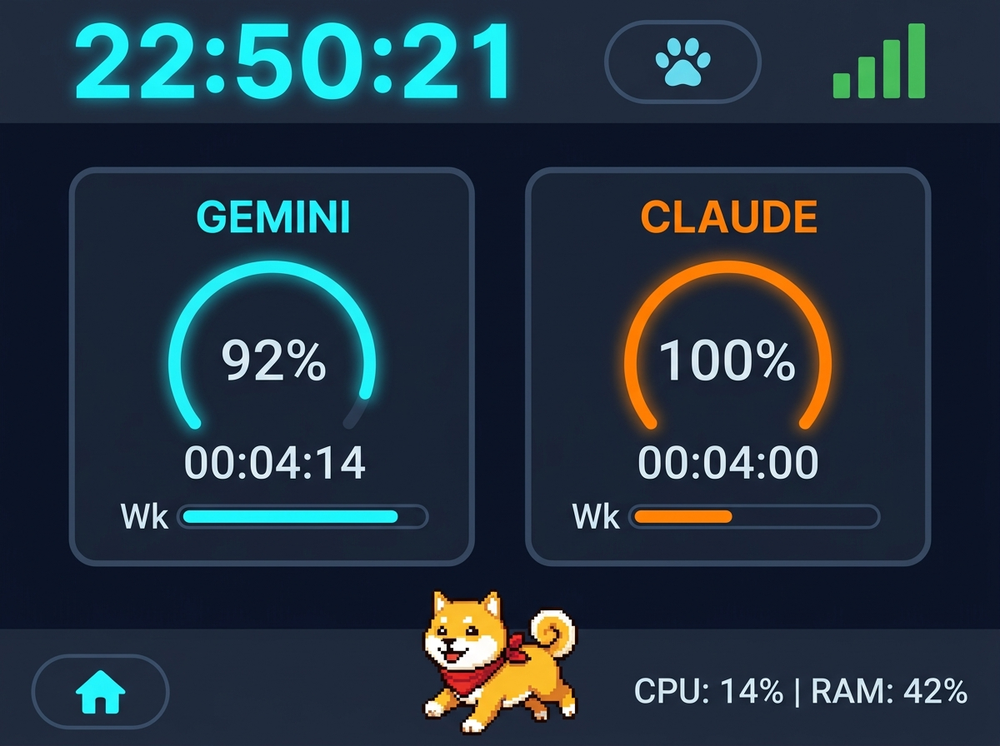

# 🐶 Concept Thiết Kế: Cún Shiba Pixel Pet Trên Màn Hình Quota Dashboard (Bản V2)

> **File ảnh demo cập nhật:** [`docs_for_me/shiba_dashboard_v2.jpg`](shiba_dashboard_v2.jpg)  
> **Điểm cải tiến V2 theo phản hồi:**  
> 1. ✅ Giữ nguyên kích thước **Header to rõ nét** giống 100% giao diện thực tế hiện tại (đồng hồ số to màu Cyan + 4 vạch sóng BLE).  
> 2. ✅ Bổ sung **Nút icon chân cún `[🐾]`** ngay trên thanh Top Bar để chạm bật/tắt (toggle) chú cún nhanh chóng.  
> 3. ✅ Bố cục 2 thẻ Quota Gemini & Claude đồng nhất hoàn hảo với phần cứng đang chạy.  
> 4. ✅ Vị trí chú cún Shiba nằm ở đáy màn hình, chạy lon ton giữa nút Home `[🏠]` và thông số `CPU/RAM`.

---

## 1. 🖼️ Hình Ảnh Mô Phỏng Giao Diện V2 Chuẩn Thực Tế

---

## 2. 📍 Bố Cục Chi Tiết & Tương Tác

### 2.1. Thanh Header Trên Cùng (Y: 0..32, Cao 32px)
* **Bên Trái:** Đồng hồ số kích thước lớn màu Cyan Neon `22:50:21` (Font 20, nổi bật và dễ nhìn trong 1 cái liếc mắt).
* **Ở Giữa / Phải:** Nút bấm cảm ứng hình dấu chân cún **`[🐾]`**:
  * Khi bấm: Ẩn hoặc Hiện chú cún Shiba.
  * Khi cún đang bật: Nút `[🐾]` sáng viền Cyan/Cam.
  * Khi tắt cún (chế độ Minimal Clean): Nút `[🐾]` màu xám mờ.
* **Bên Phải:** Cụm 4 vạch sóng Bluetooth BLE báo trạng thái kết nối máy tính.

### 2.2. Khu Vực 2 Thẻ Quota (Y: 36..204, Cao 168px)
* **Thẻ Gemini (Bên trái):** Tiêu đề Cyan, vòng cung tròn 92%, chữ đếm ngược Reset Quota 5h `00:04:14`, thanh tiến độ tuần.
* **Thẻ Claude (Bên phải):** Tiêu đề Cam, vòng cung tròn 100%, chữ đếm ngược Reset Quota 5h `00:04:00`, thanh tiến độ tuần.

### 2.3. Thanh Đáy (Bottom Bar - Y: 208..240, Cao 32px)
* **Bên Trái:** Nút chuyển màn hình Home `[🏠]`.
* **Ở Giữa:** Chú cún Shiba Pixel Art (`32x32 px`) chạy lon ton, vẫy đuôi.
* **Bên Phải:** Thông số máy tính `CPU: 14% | RAM: 42%`.

---

## 3. 💾 Ghi Nhớ Trạng Thái (NVS Persistence)
* Trạng thái Bật/Tắt chú cún được lưu vào **NVS Flash** của ESP32.
* Bạn tắt nguồn hoặc rút nguồn cắm lại, thiết bị vẫn nhớ đúng chế độ (có cún hoặc không có cún) bạn đã chọn!
