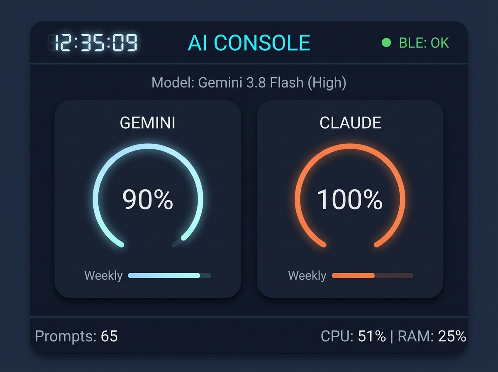

# 🎨 BẢN THIẾT KẾ GIAO DIỆN NGANG (LANDSCAPE 320x240)
> **Màn hình mục tiêu:** 2.8" TFT SPI (ILI9341 / ST7789) - **320x240 Landscape (Màn hình Ngang)**  
> **Engine đồ họa:** LVGL v8.3.x  
> **Định dạng màu:** 16-bit RGB565  

---

## 1. 🖼️ Hình Ảnh Mockup Thiết Kế Trực Quan (Giao Diện Ngang)

Bạn có thể mở trực tiếp file ảnh này trong thư mục dự án: [`docs_for_me/desk_console_ui.jpg`](./desk_console_ui.jpg)



---

## 2. 📐 Bố Cục Tổng Thể Màn Hình (320x240 px)

Màn hình được chia làm **4 tầng ngang** rõ ràng, cân xứng hoàn hảo từ hai phía và tối ưu cho góc nhìn từ bàn làm việc:

```text
+-------------------------------------------------------------+  y = 0
| [ 12:35:09 ]           AI CONSOLE             ● BLE: OK    |  Cao 28px (Top Bar)
+-------------------------------------------------------------+  y = 28
|                 Model: Gemini 3.8 Flash (High)              |  Cao 18px (Model Subtitle)
+------------------------------+------------------------------+  y = 48
|        [ CARD GEMINI ]       |        [ CARD CLAUDE ]       |
|            GEMINI            |            CLAUDE            |
|                              |                              |
|           /  90%  \          |           /  100% \          |  Cao 148px (Thân giữa)
|           \_______/          |           \_______/          |  (2 Thẻ bo góc w=148, h=146)
|        Weekly [==== ]        |        Weekly [=====]        |
+------------------------------+------------------------------+  y = 196
| Prompts: 65                               CPU: 51% | RAM: 25% |  Cao 28px (Bottom Bar)
+-------------------------------------------------------------+  y = 224 - 240
```

---

## 3. 🎨 Bảng Mã Màu Giao Diện (Dark Slate Theme)

| Vị trí | Mã Hex | Màu sắc trực quan |
| :--- | :--- | :--- |
| **Nền chính (Screen)** | `#0F172A` | Slate 900 (Xanh đen thẫm) |
| **Thanh Header / Footer** | `#1E293B` | Slate 800 (Xám xanh đậm) |
| **Thẻ Card chứa Quota** | `#162032` | Slate 850 (Bo góc radius 10) |
| **Chữ tiêu đề / Điểm nhấn** | `#38BDF8` | Cyan / Sky 400 (Phát sáng nhẹ) |
| **Chữ thông số chính** | `#F8FAFC` | Trắng sáng Slate 50 |
| **Chữ nhãn phụ / Giải thích** | `#94A3B8` | Xám nhạt Slate 400 |
| **Vòng Quota Gemini** | `#38BDF8` hoặc `#22C55E` | Cyan hoặc Xanh lá |
| **Vòng Quota Claude** | `#F97316` | Cam Amber / Coral |
| **Trạng thái BLE Connected** | `#22C55E` | Xanh lá cây |

---

## 4. 🛠️ Thông Số Kéo Thả Chi Tiết Từng Widget Trên SquareLine Studio

### 🔹 Màn hình chính (`Screen1`)
- **Background Color**: `#0F172A`

---

### 🔹 Tầng 1: Thanh Trạng Thái Trên Cùng (`top_bar`)
- Kéo 1 **Panel** vào màn hình:
  - **Tên**: `top_bar`
  - **Width**: `320`, **Height**: `28`
  - **Align**: `TOP_MID`, **X**: `0`, **Y**: `0`
  - **Background Color**: `#1E293B`, **Radius**: `0`, **Border Width**: `0`
- Kéo 3 **Label** vào bên trong `top_bar`:
  1. `lbl_clock`:
     - **Text**: `12:35:09`
     - **Align**: `LEFT_MID`, **X**: `8`, **Y**: `0`
     - **Font**: Montserrat 14 | **Color**: `#38BDF8`
  2. `lbl_title`:
     - **Text**: `AI CONSOLE`
     - **Align**: `CENTER`, **X**: `0`, **Y**: `0`
     - **Font**: Montserrat 14 | **Color**: `#FFFFFF`
  3. `lbl_ble`:
     - **Text**: `● BLE: OK`
     - **Align**: `RIGHT_MID`, **X**: `-8`, **Y**: `0`
     - **Font**: Montserrat 12 | **Color**: `#22C55E`

---

### 🔹 Tầng 2: Dòng Tên AI Model (`lbl_model`)
- Kéo 1 **Label** vào màn hình:
  - **Tên**: `lbl_model`
  - **Text**: `Model: Gemini 3.8 Flash (High)`
  - **Align**: `TOP_MID`, **X**: `0`, **Y**: `32`
  - **Font**: Montserrat 12 | **Color**: `#94A3B8`

---

### 🔹 Tầng 3 (Trái): Thẻ Quota Gemini (`card_gemini`)
- Kéo 1 **Panel** vào màn hình:
  - **Tên**: `card_gemini`
  - **Width**: `148`, **Height**: `146`
  - **Align**: `TOP_LEFT`, **X**: `8`, **Y**: `52`
  - **Background Color**: `#162032`, **Radius**: `10`, **Border Width**: `1`, **Border Color**: `#334155`
- Thêm các widget con vào bên trong `card_gemini`:
  1. **Label `lbl_gemini_title`**:
     - **Text**: `GEMINI`
     - **Align**: `TOP_MID`, **X**: `0`, **Y**: `6`
     - **Font**: Montserrat 14 | **Color**: `#38BDF8`
  2. **Arc `arc_gemini`** (Vòng tròn hiển thị % hạn mức 5 giờ):
     - **Width**: `84`, **Height**: `84`
     - **Align**: `TOP_MID`, **X**: `0`, **Y**: `26`
     - **Start Angle**: `135`, **End Angle**: `45` (tạo vòng mở đáy)
     - **Indicator Color**: `#38BDF8`, **Width**: `7`
     - **Main Background Arc Color**: `#1E293B`, **Width**: `7`
     - **Knob**: Ẩn knob (chỉnh size = 0) để tạo vòng đo liền mạch.
  3. **Label `lbl_gemini_val`** (Nằm giữa vòng Arc):
     - **Text**: `90%`
     - **Align**: `CENTER` theo Arc, **Y**: `0`
     - **Font**: Montserrat 16 | **Color**: `#FFFFFF`
  4. **Label `lbl_gemini_w_title`**:
     - **Text**: `Weekly`
     - **Align**: `BOTTOM_LEFT`, **X**: `10`, **Y**: `-8`
     - **Font**: Montserrat 10 | **Color**: `#94A3B8`
  5. **Bar `bar_gemini_w`** (Thanh tiến trình hạn mức tuần):
     - **Width**: `75`, **Height**: `6`
     - **Align**: `BOTTOM_RIGHT`, **X**: `-10`, **Y**: `-10`
     - **Indicator Color**: `#38BDF8`, **Background Color**: `#1E293B`

---

### 🔹 Tầng 3 (Phải): Thẻ Quota Claude (`card_claude`)
- Kéo 1 **Panel** vào màn hình:
  - **Tên**: `card_claude`
  - **Width**: `148`, **Height**: `146`
  - **Align**: `TOP_RIGHT`, **X**: `-8`, **Y**: `52`
  - **Background Color**: `#162032`, **Radius**: `10`, **Border Width**: `1`, **Border Color**: `#334155`
- Thêm các widget con vào bên trong `card_claude`:
  1. **Label `lbl_claude_title`**:
     - **Text**: `CLAUDE`
     - **Align**: `TOP_MID`, **X**: `0`, **Y**: `6`
     - **Font**: Montserrat 14 | **Color**: `#F97316` (Màu Cam Coral)
  2. **Arc `arc_claude`**:
     - **Width**: `84`, **Height**: `84`
     - **Align**: `TOP_MID`, **X**: `0`, **Y**: `26`
     - **Start Angle**: `135`, **End Angle**: `45`
     - **Indicator Color**: `#F97316`, **Width**: `7`
     - **Main Background Arc Color**: `#1E293B`, **Width**: `7`
  3. **Label `lbl_claude_val`**:
     - **Text**: `100%`
     - **Align**: `CENTER` theo Arc
     - **Font**: Montserrat 16 | **Color**: `#FFFFFF`
  4. **Label `lbl_claude_w_title`**:
     - **Text**: `Weekly`
     - **Align**: `BOTTOM_LEFT`, **X**: `10`, **Y**: `-8`
     - **Font**: Montserrat 10 | **Color**: `#94A3B8`
  5. **Bar `bar_claude_w`**:
     - **Width**: `75`, **Height**: `6`
     - **Align**: `BOTTOM_RIGHT`, **X**: `-10`, **Y**: `-10`
     - **Indicator Color**: `#F97316`, **Background Color**: `#1E293B`

---

### 🔹 Tầng 4: Thanh Dưới Cùng (`bottom_bar`)
- Kéo 1 **Panel** vào màn hình:
  - **Tên**: `bottom_bar`
  - **Width**: `320`, **Height**: `26`
  - **Align**: `BOTTOM_MID`, **X**: `0`, **Y**: `0`
  - **Background Color**: `#1E293B`, **Radius**: `0`, **Border Width**: `0`
- Kéo 2 **Label** vào bên trong `bottom_bar`:
  1. `lbl_prompts`:
     - **Text**: `Prompts: 65`
     - **Align**: `LEFT_MID`, **X**: `8`, **Y**: `0`
     - **Font**: Montserrat 12 | **Color**: `#CBD5E1`
  2. `lbl_system`:
     - **Text**: `CPU: 51% | RAM: 25%`
     - **Align**: `RIGHT_MID`, **X**: `-8`, **Y**: `0`
     - **Font**: Montserrat 12 | **Color**: `#CBD5E1`

---

## 5. 📤 Đường Dẫn Xuất File Trong SquareLine Studio

1. Vào **File** ➔ **Project Settings**:
   - **Width**: `320`
   - **Height**: `240`
   - **UI Files Export Path**:
     ```text
     /home/hungdk4/Documents/Code/for-me/lanchPad/esp_lanchpad_hid/components/display_ui/ui
     ```
2. Nhấn **Save**.
3. Bấm phím tắt **Ctrl + E** (**Export UI Files**).
