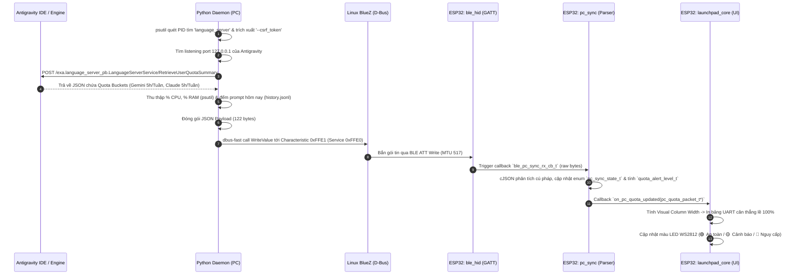

# 📡 TÀI LIỆU KỸ THUẬT: ANTIGRAVITY QUOTA & PC TELEMETRY SYNC

> **Tài liệu đặc tả kiến trúc, công nghệ và luồng xử lý (Data Flow)**  
> **Mục tiêu:** Đồng bộ thời gian thực hạn mức Antigravity AI (Gemini & Claude/GPT) và tài nguyên máy tính (CPU, RAM) từ PC sang bàn điều khiển ESP32-S3 qua kết nối không dây Bluetooth Low Energy (BLE).

---

## 1. Sơ đồ Kiến trúc & Luồng Hoạt động (Architecture Flow)



---

## 2. Chi Tiết Công Nghệ Sử Dụng (Technology Stack)

### 2.1. Phía Máy Tính (Host PC - Python 3)
| Hạng mục | Công nghệ / Thư viện | Đặc tả kỹ thuật & Giải pháp |
| :--- | :--- | :--- |
| **Thu thập Quota** | `urllib.request` + Process Inspection | • Tự động quét tiến trình `language_server` đang chạy.<br>• Trích xuất cờ `--csrf_token` từ cmdline.<br>• Gọi trực tiếp API nội bộ: `POST 127.0.0.1:<port>/exa.language_server_pb.LanguageServerService/RetrieveUserQuotaSummary`<br>• Header: `x-codeium-csrf-token: <csrf_token>`<br>• Zero cloud dependency, phản hồi tức thì (< 2ms). |
| **System Telemetry**| `psutil` | • Đọc % CPU tổng thể (`cpu_percent`) và % RAM đã dùng (`virtual_memory().percent`). |
| **Hoạt động AI** | `json` (file IO) | • Đếm số prompt/turns gửi trong ngày từ `~/.gemini/antigravity-cli/history.jsonl`.<br>• Lấy model hiện tại từ `cli.log` (`label="Gemini 3.8 Flash (High)"`). |
| **BLE Transport** | `dbus-fast` (D-Bus System Bus) | • Giao tiếp trực tiếp với BlueZ qua đường truyền `org.bluez.GattCharacteristic1`.<br>• **Không cần quét BLE (Zero Scanning)**: Gửi thẳng tới thiết bị đang kết nối HID, độ trễ < 5ms. |

### 2.2. Phía Thiết Bị Nhúng (ESP32-S3 Firmware)
| Hạng mục | Thành phần | Đặc tả kỹ thuật & Giải pháp |
| :--- | :--- | :--- |
| **Hệ điều hành / RTOS** | ESP-IDF v5.3.5 / FreeRTOS | • Mô hình lập trình tách tầng, Non-blocking, chạy đa tác vụ. |
| **GATT Service** | `components/ble_hid` | • Đăng ký song song 3 GATT Tables: **Device Info (0x180A)**, **HID Service (0x1812)** và **Custom PC Sync Service (0xFFE0)**.<br>• Characteristic `0xFFE1` hỗ trợ Read/Write/Write Without Response.<br>• Thiết lập `esp_ble_gatt_set_local_mtu(517)` nhận trọn vẹn gói tin JSON trong 1 khung truyền. |
| **Parser & Protocol** | `components/pc_sync` | • Sử dụng thư viện nhúng `cJSON` tối ưu bộ nhớ.<br>• Quản lý trạng thái bằng `enum` tường minh. |
| **UI & Báo hiệu** | `components/launchpad_core` | • Thuật toán đo bề rộng trực quan (**Visual Column Width**) bù trừ ký tự Unicode tiếng Việt và emoji 2-cột, đảm bảo bảng viền `|` thẳng tắp 100%.<br>• Tự động kích hoạt LED RGB WS2812 đổi màu cảnh báo khi Quota xuống thấp. |

---

## 3. Cấu Trúc Dữ Liệu & Giao Thức (Protocol Specification)

### 3.1. Định Dạng Gói Tin JSON (Host -> ESP32)
Gói tin được gửi dưới dạng chuỗi UTF-8 JSON gọn nhẹ (142 bytes):
```json
{
  "model": "Gemini 3.8 Flash (High)",
  "time": "01:23:07",
  "quota": 42,
  "g_w": 88,
  "c_5h": 100,
  "c_w": 100,
  "prompts": 49,
  "cpu": 33,
  "ram": 58
}
```
- `model`: Tên model AI đang được cấu hình trên Antigravity.
- `time`: Giờ Việt Nam (UTC+7) chuẩn lấy từ Internet NTP/Google (độc lập với đồng hồ máy tính).
- `quota` (hoặc `g_5h`): % Hạn mức 5 giờ của Gemini (hạn mức tiêu thụ chính khi dev).
- `g_w`: % Hạn mức tuần của Gemini.
- `c_5h`: % Hạn mức 5 giờ của nhóm Claude / GPT.
- `c_w`: % Hạn mức tuần của nhóm Claude / GPT.
- `prompts`: Tổng số câu lệnh/lượt trao đổi AI thực hiện trong ngày.
- `cpu`: % Sử dụng CPU máy tính Host.
- `ram`: % Sử dụng RAM máy tính Host.

---

### 3.2. Định Nghĩa Trạng Thái Máy (ESP32 State Machine)

#### Trạng thái phân tích gói tin (`pc_sync_state_t`):
```c
typedef enum {
    PC_SYNC_STATE_UNINITIALIZED = 0, // Module chưa khởi tạo
    PC_SYNC_STATE_IDLE,              // Đang chờ dữ liệu từ Host qua BLE
    PC_SYNC_STATE_RECEIVING,         // Đang nhận chuỗi bytes từ BLE GATT
    PC_SYNC_STATE_PARSED_SUCCESS,    // Parse cJSON thành công, dữ liệu hợp lệ
    PC_SYNC_STATE_ERROR_FORMAT,      // Lỗi định dạng JSON (sai cú pháp)
    PC_SYNC_STATE_ERROR_INVALID_VAL  // Lỗi giá trị nằm ngoài phạm vi (vd: quota > 100%)
} pc_sync_state_t;
```

#### Mức độ cảnh báo Quota (`quota_alert_level_t`):
```c
typedef enum {
    QUOTA_ALERT_SAFE = 0,    // Quota >= 50%  -> An toàn (🟢 Xanh lá)
    QUOTA_ALERT_WARNING,     // Quota 20%-49% -> Cảnh báo (🟡 Vàng)
    QUOTA_ALERT_CRITICAL     // Quota < 20%   -> Nguy cấp (🔴 Đỏ cảnh báo)
} quota_alert_level_t;
```

---

## 4. Định Dạng Hiển Thị Chuẩn Hóa Trên UART ESP32

```text
+--------------------------------------------------------------------+
| [PC_SYNC] CAP NHAT DU LIEU QUOTA ANTIGRAVITY QUA BLE               |
+--------------------------------------------------------------------+
| Gio Viet Nam:       01:23:07 (UTC+7)                               |
| AI Model:           Gemini 3.8 Flash (High)                        |
| [GEMINI] 5h Limit:   42% [CẢNH BÁO 🟡]  | Weekly:  88%             |
| [CLAUDE] 5h Limit:  100% [AN TOÀN  🟢]  | Weekly: 100%             |
| Số Prompts hôm nay: 49                                             |
| Host PC Telemetry:  CPU: 33%            | RAM: 58%                 |
| Trạng thái Module:  PARSED_SUCCESS                                 |
+--------------------------------------------------------------------+
```

> **Đặc điểm nổi bật:**
> 1. **Loại bỏ hoàn toàn icon rác**: Giữ tính tối giản, chỉ dùng nút chấm màu biểu thị cảnh báo trực quan.
> 2. **Căn lề laser (Pixel-perfect Column Alignment)**: Mọi dòng đều có chiều rộng hiển thị chuẩn 70 cột ký tự; viền ngoài `|` và cột phân cách giữa `|` thẳng tắp.
